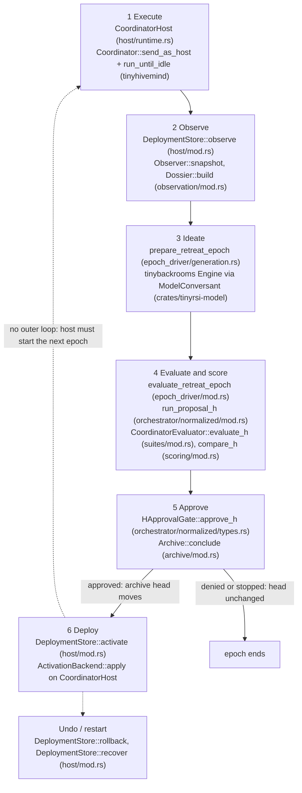

# Architecture

TinyRSI is a Rust library that a host program uses to improve a
[tinyhivemind](https://github.com/tinyhumansai/tinyhivemind) hive one reviewed
change at a time. A hive is a typed package (seats, prompts, context, memory
identities, roster, policies) plus an exact memory image. The library never
runs on its own: the host owns the coordinator, the model credentials, the
private test tasks and the human who approves changes. TinyRSI supplies the
durable bookkeeping and the gates between those pieces.

The crate also holds a small in-memory `Lineage` ledger of graded
candidates, independent of the loop described here; see
[`crates/tinyrsi/src/lineage/README.md`](../crates/tinyrsi/src/lineage/README.md).

Terms in *italics* below are defined in the [glossary](glossary.md). For the
same epoch traced through the files it writes, read the
[loop walkthrough](rsi/loop-walkthrough.md).

## One epoch

An *epoch* is one pass from live work to a possible deployment. Every arrow
below is a direct function call made by the host; there is no scheduler inside
the library. Paths are relative to `crates/tinyrsi/src/`. Steps 1, 2 and 6 need
the `host` Cargo feature.

1. **Execute.** The host runs real work through a coordinator built by
   `CoordinatorHost`, whose runners come from a `RunnerFactory` (the bundled
   one is `ControlledRunnerFactory` in `suites/factory.rs`). Runners measure
   token usage and checker outcomes outside the model's own output.
2. **Observe.** `DeploymentStore::observe` reads transcript sequence numbers
   and episode phases since the last cursor, discards message bodies, and
   checkpoints the result as epoch *N*. `Dossier::build` joins that observation
   with the host's measured usage and verifier outcomes into the public
   *dossier*. `EvidenceJournal` (`evidence_journal/`) is the stricter
   alternative that journals each turn callback before it is consumed.
3. **Ideate.** `prepare_retreat_epoch` refuses to run unless the archive head
   is the deployed design and no deployment is pending. It records an intent
   in the `EpochJournal`, then asks a model for typed *proposals*, either
   through the tinybackrooms critic-pair *retreat* Engine (with or without
   `DurableRetreatMemory` recall) or as one direct call. Strictly decoded
   proposals are persisted before anything evaluates them.
4. **Evaluate and score.** `evaluate_retreat_epoch` passes each prepared
   proposal to `run_proposal_h` in order. That function first rejects
   malformed, ungrounded and wrong-class proposals and exact repeats. It then
   preregisters the proposal in the `Archive`, applies the patch and pins
   memory (language-guard failures and content duplicates stop here, before
   any trial), and runs three *stages* (screen, selection, confirmation) of paired
   incumbent-versus-candidate trials on frozen private suites. Each stage is
   scored with the normalized *H score* and a bootstrap interval. Any stage
   that fails stops the proposal with a `ReasonCode`.
5. **Approve.** After a passing confirmation the `HApprovalGate` sees the
   exact candidate ID, proposal and comparison. Its answer is persisted, and
   `Archive::conclude` writes an accepted or rejected record. Only an approved
   candidate moves the archive head, and the epoch stops at the first
   acceptance.
6. **Deploy.** Acceptance changes *selection*, not the running system. The
   host must stop admission and call `DeploymentStore::activate`, which
   journals an intent, rebuilds the coordinator on the accepted package and
   memory watermarks, then records `deployed_id`. `rollback` restores the
   deployed design's accepted parent; `recover` finishes or compensates an
   interrupted transition after a crash.

## Ownership boundaries

| Concern | Owned by | In this repo |
| --- | --- | --- |
| Coordinator, seats, transcripts | tinyhivemind (`tinyhivemind-hives`) | adapted by `host/` and `observation/` |
| Hive package format, patches, content IDs | tinyhivemind (`tinyhivemind-lang`) | re-exported; never redefined |
| Retreat generation engine | tinybackrooms | driven by `epoch_driver/`, `retreat/` |
| Private tasks and checkers | the host | frozen and fingerprinted by `suites/` |
| Model credentials and provider | the host | `tinyrsi-model` reads `OPENROUTER_API_KEY` at call time |
| Human approval | the host | only a trait (`HApprovalGate`) |
| Selection history | this crate | `archive/` |
| Deployment state | this crate | `host/` (`DeploymentStore`) |

Two durable facts are kept apart on purpose: what the archive has *selected*
(`Archive::head`) and what a coordinator actually *runs*
(`DeploymentCheckpoint::deployed_id`). An acceptance never changes the second
one by itself.

## What is missing

These gaps are real and are not hidden by the examples:

- **No multi-epoch outer loop.** Nothing in the crate calls the six steps
  repeatedly. `examples/complete_openrouter.rs` runs one worked epoch, then a
  preregistered experiment whose trials each run one epoch from a fresh
  directory. A host that wants continuous improvement has to write that loop,
  including when to stop admission and how to choose the next epoch's patch
  class.
- **Approval gates are scripted.** The examples use `fixtures::Deny` (always
  no) and `fixtures::ContextGate` (yes for any accepted context patch) in
  `examples/complete/fixtures.rs`. There is no production human-approval
  service or UI.
- **`ApplyAt` is not acted on.** `run_proposal_h` returns
  `HCandidateOutcome::apply_at` (next turn, replace agent, manage roster, or
  between sessions) for approved designs, but no host code reads it.
  `CoordinatorHost` always performs a full coordinator rebuild between
  sessions, whatever the patch class.
- **Scientific acceptance is open.** Empirical anchors, curated multi-family
  suites, calibrated proposal ranking and a learned orchestrator do not exist
  yet; the published 24-attempt experiment is inconclusive.

The phase-by-phase list with tracker links is in
[`rsi/remaining-work.md`](rsi/remaining-work.md); implemented mechanisms are
in [`rsi/phases.md`](rsi/phases.md).

## Planned

Two pieces of follow-up work are planned but not part of the code today: a
script-subject loop that runs repeated epochs against a small scripted
subject (to be specified in `docs/specs/script-loop.md`), and a live
visualizer of epoch progress (to live under `apps/rsi-viz`). Neither file
exists yet, and nothing in this document depends on them.

## Where to read next

- [Glossary](glossary.md) for every term above.
- [Loop walkthrough](rsi/loop-walkthrough.md) for the on-disk evidence.
- Module READMEs under `crates/tinyrsi/src/<module>/README.md` for design and
  constraints of each piece; [`host/README.md`](../crates/tinyrsi/src/host/README.md)
  covers the host lifecycle in order.
- [Host runtime spec](specs/host-runtime.md) and
  [RSI framework](rsi/specs/rsi-framework.md) for the contracts.
